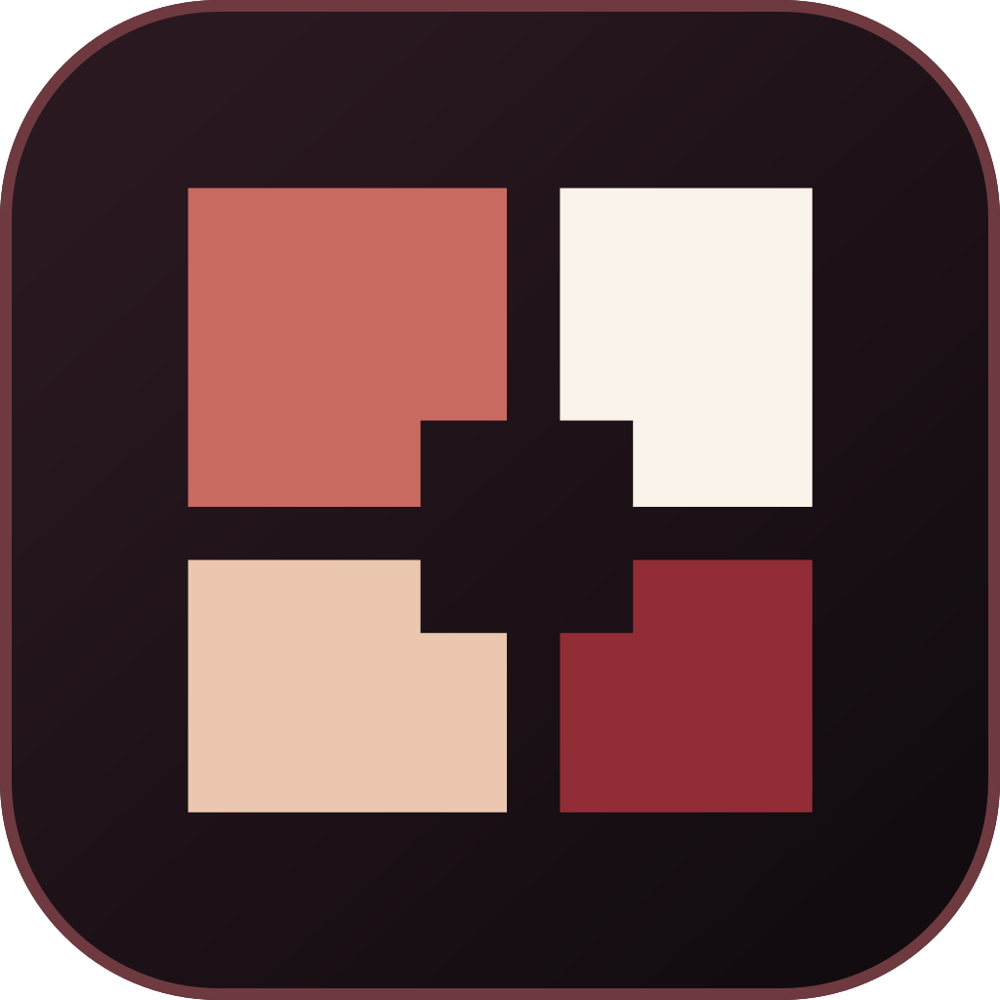

<p align="center">
  
</p>

<a id="noctweave-relay"></a>

<h1 align="center">Noctweave Relay</h1>

<p align="center"><strong>Run your relay from a native Mac control panel.</strong></p>

<p align="center">
  <a href="#overview">Overview</a> ·
  <a href="#quick-start">Quick start</a> ·
  <a href="#features">Features</a> ·
  <a href="#security-and-privacy">Security</a> ·
  <a href="#documentation">Documentation</a>
</p>

## Overview

Noctweave Relay manages a self-hosted relay on your Mac. Configure networking,
storage, access, federation, and realtime services in SwiftUI while clients
retain control of message and attachment encryption.

| Detail | At a glance |
| --- | --- |
| Platform | macOS |
| Built with | SwiftUI · NoctweaveCore · optional coturn |
| License | [AGPL-3.0-or-later](LICENSE) |

<a id="requirements"></a>

<a id="build"></a>

## Quick start

Run commands from this repository. The Xcode project expects
`NoctweaveCore` in the parent checkout.

- Xcode 26 or later
- macOS 26 SDK
- `NoctweaveCore` checked out as a sibling directory at `../NoctweaveCore`

Open `Noctweave Relay.xcodeproj` in Xcode, or build from the command line:

```sh
xcodebuild \
  -project "Noctweave Relay.xcodeproj" \
  -scheme "Noctweave Relay" \
  -destination 'platform=macOS' \
  build
```

<a id="what-it-includes"></a>

## Features

- Local relay start, stop, status, and runtime diagnostics
- Disk-backed or ephemeral in-memory storage
- TCP and HTTP endpoint configuration, with native TLS or TLS reverse-proxy support
- Password-based relay access control
- Optional bounded one-use rendezvous for Relay Pairing
- Default-off same-relay pairing discovery with two-minute process-local listings
- Attachment retention and temporal-bucketing controls
- Configurable NoctCord realtime routes, durable shared logs, presence, and media blobs
- Explicit `solo`, `manual`, `curated`, and `open` federation modes
- Coordinator and relay-directory configuration

## NoctCord community services

Open the dedicated **NoctCord** panel to configure the relay capabilities used
by NoctCord communities. **Apply Recommended Profile** selects a Standard relay,
disables relay-wide temporal bucketing for immediate delivery, enables encrypted
realtime routes and durable shared logs, and permits bounded encrypted media.
Presence and media can then be disabled independently.

The panel reports whether the relay is ready for remote NoctCord clients.
Remote realtime routes require native Relay TLS or a trusted TLS reverse proxy;
loopback development is allowed without TLS. Voice and screen-sharing traversal
remain optional and can use the relay app's bundled coturn service.

These are transport capabilities, not a server-side community database. The
relay does not receive community names, channels, roles, memberships, message
plaintext, or media plaintext.

## Optional call traversal

Open **Transport** and enable **Call connectivity**. The native app bundles a
minimal coturn 4.17.2 service, generates its private credential key, advertises
`nw.ice-service@1`, issues short-lived TURN credentials, and starts or stops the
service with the relay. A local-network address is detected automatically, so a
LAN relay needs no separate coturn install, Docker container, account, or manual
secret configuration.

For Internet calls, route the displayed TURN TCP/UDP port and UDP allocation
range to the Mac. Ordinary HTTP reverse proxies cannot carry TURN. Operators
who already run coturn can select **External** under **Advanced call settings**.
The credential key remains in Keychain and is never included in relay info. See
the public
[`coturn_call_traversal.md`](https://github.com/luizwidmer/Noctweave/blob/main/NoctweaveDocumentation/coturn_call_traversal.md)
guide for network examples and threat boundaries.

The generated coturn configuration is transient and removed after startup. A
restored managed relay can generate a new TURN key if its Keychain item is not
available; this expires old temporary call credentials without changing relay
identity or stored data. External deployments must restore the same secret on
both coturn and the relay.

## Security and privacy

Managed TURN permits public peer destinations and blocks loopback, private, link-local, and other special address ranges. It does not provide access to the relay operator’s LAN. Private-network TURN deployments must use an independently configured external service.

The macOS relay serves native TCP frames or HTTP (`POST /relay`, `GET /health`, and
`GET /info`). It does not implement a WebSocket listener; use the sibling Linux
relay for WebSocket/WSS endpoints.

This repository is an operator application, not a hosted relay service. Messages and attachments must be encrypted by clients before submission. Relays store and route ciphertext and must not be treated as trusted plaintext processors.

## Development

For tests, use the root-level `../scripts/run-native-app-tests.sh relay` command.
It uses ad-hoc local signing, a fresh test-only bundle identifier, and
process-local XCTest secrets, so it neither claims the production sandbox nor
unlocks a developer signing certificate or touches production Keychain records.


### Archive symbols for Managed coturn


The prebuilt `ManagedCoturn.bundle` and
`Symbols/ManagedCoturn.bundle.dSYM` are a matching pair. The **Include Managed
coturn symbols** build phase checks their UUIDs and source debug information,
then copies the dSYM to Xcode's symbol output directory. An archive must contain
both `Noctweave Relay.app.dSYM` and `ManagedCoturn.bundle.dSYM` in `dSYMs`.
The helper symbols stay outside the app bundle.

To rebuild coturn, install the OpenSSL 3 and libevent development libraries
(for example, `brew install openssl@3 libevent pkgconf`) and run:

```sh
Scripts/build-managed-coturn.sh
```

The script verifies the pinned coturn source checksum, builds the minimal arm64
helper with debug information, retains the dSYM before stripping, and signs the
helper locally with its sandbox inheritance entitlements. Xcode signs the helper
again when embedding it. `OPENSSL_PREFIX` and `LIBEVENT_PREFIX` can select other
installed dependency prefixes; `COTURN_SOURCE_ARCHIVE` can supply a previously
downloaded source tarball, which is checked against the same checksum.
`Symbols/ManagedCoturn-build.txt` records the toolchain, dependencies, and UUID.
Keep the regenerated helper, signature, dSYM, and build record together.

After replacing a helper that lacked symbols, create a new archive. A dSYM from
the rebuilt helper cannot repair an older archive with a different helper UUID.
Check a new archive with:

```sh
xcrun dwarfdump --uuid \
  "$ARCHIVE_PATH/Products/Applications/Noctweave Relay.app/Contents/Helpers/ManagedCoturn.bundle/Contents/MacOS/turnserver" \
  "$ARCHIVE_PATH/dSYMs/ManagedCoturn.bundle.dSYM"
```

See [RELAY_OPERATIONS.md](RELAY_OPERATIONS.md) for configuration and operating details.

## App identity migration

This project replaces the former Noctyra product identity. Its product name, scheme, bundle identifier, source symbols, and local persistence labels now use Noctweave. Existing Noctyra installations and their local data are not migrated automatically.

## Documentation

| Read | For |
| --- | --- |
| [Relay operations](RELAY_OPERATIONS.md) | Configuration and everyday operation |
| [Third-party notices](THIRD-PARTY-NOTICES.md) | Bundled dependencies and licenses |
| [Linux / Docker relay](https://github.com/luizwidmer/Noctweave/blob/main/NoctweaveRelayServer/README.md) | Server deployment and WebSocket support |
| [Operator hardening](https://github.com/luizwidmer/Noctweave/blob/main/NoctweaveDocumentation/relay_ops_hardening_guide.md) | Transport, secrets, and deployment boundaries |

## License

This project is free software licensed under the GNU Affero General Public License, version 3 or, at your option, any later version (`AGPL-3.0-or-later`). See [LICENSE](LICENSE).

Bundled dependencies and their licenses are listed in
[THIRD-PARTY-NOTICES.md](THIRD-PARTY-NOTICES.md).

If you modify the program and let users interact with it over a network, the AGPL requires that those users be offered the Corresponding Source for the version they are using. This summary is informational; the license text controls.
